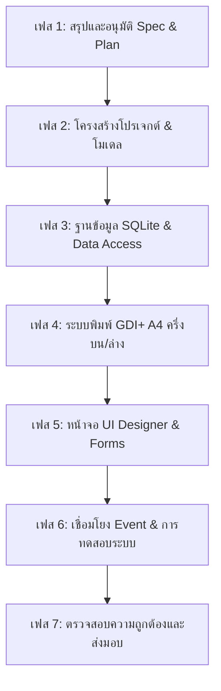

# แผนการพัฒนาโปรเจกต์ (Implementation Plan)
## ระบบออกใบรับซ่อมสินค้า (Repair Ticket System)
**เวอร์ชันเป้าหมาย:** .NET 8.0 Windows Forms (C# 12)  
**ฐานข้อมูล:** SQLite (`Microsoft.Data.Sqlite`)  
**โฟลเดอร์บันทึกโค้ด:** `C:\gemini_code\RepairTicket`  
**โฟลเดอร์บันทึกเอกสาร:** `C:\gemini_code\RepairTicket\docs`  
**อ้างอิงข้อกำหนด:** [`docs/SPECIFICATION.md`](file:///C:/gemini_code/RepairTicket/docs/SPECIFICATION.md)

---

## 1. รายการไฟล์และโครงสร้างโฟลเดอร์ที่จะสร้าง (File Manifest)

ระบบจะจัดโครงสร้างตามหลัก Clean Architecture เพื่อความเรียบร้อยและง่ายต่อการบำรุงรักษา:

```
C:\gemini_code\RepairTicket\
│
├── RepairTicket.csproj                 # ไฟล์โปรเจกต์ .NET 8.0 WinForms + Microsoft.Data.Sqlite
├── Program.cs                          # จุดเริ่มต้นโปรแกรม (DPI Setup, DB Bootstrap, Run Form1)
│
├── Models\                             # คลาสข้อมูล (Domain Entities)
│   ├── RepairJob.cs                    # คลาสเก็บข้อมูลงานซ่อม (Id, JobNo, JobDate, CustomerName, DeviceSymptom)
│   ├── ShopSetting.cs                  # คลาสเก็บข้อมูลร้าน (Id, ShopName, ShopAddress)
│   └── WordDictionaryItem.cs           # คลาสเก็บคำศัพท์ช่างซ่อม (WordId, WordText, UsageCount)
│
├── Data\                               # การเข้าถึงฐานข้อมูล SQLite (Data Access Layer)
│   ├── DatabaseInitializer.cs         # ตัวสร้างตารางอัตโนมัติ (DDL 3 ตาราง) และแทรกคำศัพท์/ข้อมูลร้านเริ่มต้น
│   ├── RepairJobRepository.cs          # เมธอด CRUD และค้นหาใบงานซ่อมด้วย Parameterized SQL
│   ├── ShopSettingRepository.cs        # เมธอดดึงและอัปเดตข้อมูลร้านค้า
│   └── WordDictionaryRepository.cs     # เมธอดค้นหาคำแนะนำ (LIKE/Contains) และเรียนรู้คำศัพท์ใหม่ (Upsert)
│
├── Services\                           # ระบบการพิมพ์และตรรกะธุรกิจ (Services & Printing)
│   ├── TicketPrintDocument.cs          # ตัวจัดการวาดใบพิมพ์ A4 ครึ่งบน/ล่าง (GDI+ Precision Math)
│   └── PosSlipPrintDocument.cs         # ตัวสร้างและพิมพ์สลิปความร้อน POS 58mm ด้วยระบบ Bitmap (ภาษาไทยคมชัด 100%)
│
├── UI\                                 # ส่วนติดต่อผู้ใช้ (Windows Forms Presentation Layer)
│   ├── Form1.cs                        # โค้ดควบคุมเหตุการณ์, ระบบคำแนะนำ Gboard และตรรกะหน้าจอหลัก
│   ├── Form1.Designer.cs               # การออกแบบหน้าจอหลัก (ปุ่ม, FlowLayoutPanel แถบคำแนะนำ, ตาราง DataGridView)
│   ├── SettingsForm.cs                 # โค้ดควบคุมหน้าต่างตั้งค่าร้าน
│   └── SettingsForm.Designer.cs        # การออกแบบหน้าต่างป็อปอัปตั้งค่าข้อมูลร้าน
│
└── docs\                               # เอกสารโครงการ
    ├── prompt.txt                      # ข้อกำหนดตั้งต้นของผู้ใช้
    ├── SPECIFICATION.md                # เอกสารข้อกำหนดระบบฉบับเต็ม
    └── PLAN.md                         # แผนการพัฒนาฉบับนี้
```

---

## 2. ขั้นตอนการพัฒนารายเฟส (Phase-by-Phase Roadmap)



### เฟส 1: สรุปและนำเสนอ Spec & Plan ให้ผู้ใช้พิจารณา (ขั้นตอนปัจจุบัน)
- **เป้าหมาย:** สรุปฟังก์ชันการทำงาน โครงสร้างหน้าจอ ตารางฐานข้อมูล และระบบพิมพ์ A4 แบบแบ่งครึ่ง ให้ผู้ใช้ตรวจดูก่อนเริ่มลงมือเขียนโค้ดจริง
- **ผลลัพธ์:** ไฟล์ `docs/SPECIFICATION.md` และ `docs/PLAN.md` ถูกบันทึกครบถ้วน
- **เกณฑ์การผ่าน (Gate):** ผู้ใช้เห็นชอบกับโครงสร้างและแนวทางการพัฒนา

---

### เฟส 2: สร้างไฟล์โครงสร้างโปรเจกต์และโมเดลข้อมูล (Project Scaffolding & Models)
- **งานที่จะทำ:**
  1. สร้าง `RepairTicket.csproj`:
     - กำหนด `<TargetFramework>net8.0-windows</TargetFramework>`
     - กำหนด `<UseWindowsForms>true</UseWindowsForms>`
     - ติดตั้ง PackageReference: `Microsoft.Data.Sqlite` (เวอร์ชัน 8.0.0 หรือใหม่กว่า)
     - กำหนด `<Nullable>enable</Nullable>` และ `<ImplicitUsings>enable</ImplicitUsings>`
  2. สร้างคลาส `Models/RepairJob.cs`:
     - คุณสมบัติ: `Id`, `JobNo`, `JobDate`, `CustomerName`, `DeviceSymptom`
  3. สร้างคลาส `Models/ShopSetting.cs`:
     - คุณสมบัติ: `Id`, `ShopName`, `ShopAddress`
  4. สร้างคลาส `Models/WordDictionaryItem.cs`:
     - คุณสมบัติ: `WordId`, `WordText`, `UsageCount`
- **เกณฑ์การตรวจสอบ:** รูปแบบไวยากรณ์ C# ถูกต้องและไม่มีข้อผิดพลาด

---

### เฟส 3: พัฒนาระบบฐานข้อมูล SQLite (Database Layer & Repositories)
- **งานที่จะทำ:**
  1. สร้าง `Data/DatabaseInitializer.cs`:
     - ฟังก์ชัน `Initialize()` ตรวจสอบและสร้างฐานข้อมูล `repair_shop.db`
     - สั่งประมวลผล DDL `CREATE TABLE IF NOT EXISTS RepairJobs (...)`
     - สั่งประมวลผล DDL `CREATE TABLE IF NOT EXISTS ShopSettings (...)`
     - สั่งประมวลผล DDL `CREATE TABLE IF NOT EXISTS WordDictionary (...)`
     - ตรวจสอบจำนวนแถวใน `ShopSettings` หากเท่ากับ 0 ให้ `INSERT` ข้อมูลร้านเริ่มต้นทันที
     - ตรวจสอบจำนวนแถวใน `WordDictionary` หากเท่ากับ 0 ให้ `INSERT` คำศัพท์ช่างซ่อมเริ่มต้น (จอแตก, เปิดไม่ติด, ชาร์จไม่เข้า, แบตเสื่อม, ลงวินโดวส์ใหม่, ล้างเครื่อง, เปลี่ยนอะไหล่, ฯลฯ)
  2. สร้าง `Data/RepairJobRepository.cs`:
     - `Insert(RepairJob job)`: บันทึกใบงานใหม่ พร้อมคืนค่า Id
     - `Update(RepairJob job)`: อัปเดตข้อมูลใบงานเดิม
     - `GetAll()`: ดึงใบงานทั้งหมดเรียงลำดับ `ORDER BY Id DESC`
     - `Search(string keyword)`: ค้นหาด้วยเงื่อนไข `JobNo LIKE $q OR CustomerName LIKE $q` เรียง `ORDER BY Id DESC`
     - `GenerateNextJobNo()`: คำนวณเลขที่ใบงานถัดไปอัตโนมัติในรูปแบบ `YYMMDD-hhmmss` (เช่น `261119-100524`) พร้อมตรวจสอบความซ้ำซ้อนในฐานข้อมูล
     - **ข้อกำหนดความปลอดภัย:** ใช้ `SqliteParameter` สำหรับค่าทุกตัว 100% ป้องกัน SQL Injection
  3. สร้าง `Data/ShopSettingRepository.cs`:
     - `GetSettings()`: ดึงข้อมูลร้านค้าแถวแรก (Id = 1)
     - `SaveSettings(ShopSetting setting)`: บันทึกอัปเดตข้อมูลชื่อร้านและที่อยู่
  4. สร้าง `Data/WordDictionaryRepository.cs`:
     - `GetSuggestions(string token, int limit = 5)`: ค้นหาคำศัพท์ด้วย `WordText LIKE '%' || $token || '%'` เรียงลำดับ `UsageCount DESC, length(WordText) ASC`
     - `GetTopWords(int limit = 5)`: ดึงคำศัพท์ยอดนิยมสูงสุดเมื่อช่องกรอกว่างหรือขึ้นคำใหม่
     - `LearnWords(IEnumerable<string> words)`: บันทึกคำศัพท์ใหม่หรือเพิ่มความถี่ `UsageCount` ด้วย SQLite Upsert (`ON CONFLICT(WordText) DO UPDATE SET UsageCount = UsageCount + 1`)
- **เกณฑ์การตรวจสอบ:** มีบล็อก `using` กำกับทุกการเชื่อมต่อ และทดสอบตรรกะคำสั่ง SQL ผ่าน Parameterized Queries

---

### เฟส 4: พัฒนาระบบการพิมพ์ GDI+ (A4 Dual-Section ขั้นต่ำ 18pt & POS 58mm Bitmap Slip)
- **งานที่จะทำ:**
  1. สร้างคลาส `Services/TicketPrintDocument.cs` (ระบบพิมพ์ A4 - ฟอนต์ขั้นต่ำ 18pt ทุกจุด):
     - กำหนดขนาดกระดาษตั้งต้นเป็น A4 Portrait (827 × 1169 หน่วยที่ 100 DPI)
     - **เกณฑ์ฟอนต์ขั้นต่ำ 18pt บนกระดาษ A4:**
       - ชื่อร้านค้า: `22pt Bold`
       - หัวเรื่องเอกสาร: `20pt Bold`
       - ป้ายกำกับสำเนา, หัวข้อฟิลด์, ข้อมูลใบงาน, อาการเสีย, และช่องลงชื่อ: `18pt` ทั้งหมด
     - จัดการอีเวนต์ `OnPrintPage(PrintPageEventArgs e)`:
       - **กึ่งกลางกระดาษ (Y = 584):** วาดเส้นประแนวนอนคั่นกลางด้วย `Pen(Color.Gray) { DashStyle = DashStyle.Dash }` พร้อมข้อความแนะนำรอยตัด
       - **ส่วนบน (Y: 40 -> 520):** เรียกฟังก์ชัน `DrawTicketSection(e.Graphics, offsetY: 40, "(ส่วนของร้านค้า)", job, shop)`
       - **ส่วนล่าง (Y: 615 -> 1095):** เรียกฟังก์ชัน `DrawTicketSection(e.Graphics, offsetY: 615, "(ส่วนของลูกค้า)", job, shop)`
  2. สร้างคลาส `Services/PosSlipPrintDocument.cs` (ระบบพิมพ์สลิปความร้อน POS 58mm ด้วย Bitmap):
     - **แก้ปัญหาภาษาไทยขาด/เพี้ยน/สระลอย:** ใช้วิธีเรนเดอร์สลิปลงบนหน่วยความจำภาพ `Bitmap` กว้าง 384 พิกเซล (พื้นที่พิมพ์ 48mm ของกระดาษ 58mm)
     - คำนวณความสูงตามเนื้อหาจริง แล้ววาดข้อความภาษาไทยด้วย GDI+ Typography (`Tahoma` / `Segoe UI`) ตัวอักษรคมชัด สระ 3 ระดับถูกต้องสมบูรณ์ 100%
     - วาดเนื้อหา 2 สำเนาต่อเนื่องในม้วนเดียว: `[ ส่วนของร้านค้า ]` และ `[ ส่วนของลูกค้า ]` พร้อมเส้นประรอยฉีก `- - - ฉีกตามรอยปรุ - - -`
     - ใน `OnPrintPage`: ส่งภาพ Bitmap พิมพ์ออกทางเครื่องพิมพ์สลิป POS ผ่าน `e.Graphics.DrawImage(slipBmp, 0, 0)`
- **เกณฑ์การตรวจสอบ:** วัดพิกัดพิมพ์ A4 ไม่เกินระยะขอบ 50 หน่วย และสลิป 58mm แสดงผลภาษาไทยคมชัด ไม่ตกขอบ ไม่เป็นตัวอักษรขยะ

---

### เฟส 5: ออกแบบหน้าจอ UI (Designer & Forms Implementation - Minimum 16pt Font)
- **งานที่จะทำ:**
  1. สร้าง `UI/SettingsForm.Designer.cs` & `UI/SettingsForm.cs`:
     - ฟอนต์หลักของฟอร์ม: **`Segoe UI, 16pt`** หรือ **`Tahoma, 16pt`** (ตามเกณฑ์ขั้นต่ำ 16pt)
     - หน้าต่างตั้งค่าข้อมูลร้าน (`FormBorderStyle = FixedDialog`, `MaximizeBox = false`, `StartPosition = CenterParent`, ขนาดพอเหมาะสำหรับข้อความ 16pt)
     - ช่องกรอก: ชื่อร้าน (`TextBox`), ที่อยู่และเบอร์โทรร้าน (`TextBox` Multiline, ความสูงช่องกรอกรองรับฟอนต์ 16pt สระไทยไม่ขาด)
     - ปุ่ม: "💾 บันทึกการตั้งค่า" (`btnSave`), "❌ ยกเลิก" (`btnCancel`) ฟอนต์ 16pt ขนาดปุ่มใหญ่กดง่าย
  2. สร้าง `UI/Form1.Designer.cs`:
     - **เกณฑ์ฟอนต์ขั้นต่ำ 16pt ทั่วทั้งหน้าจอ:** กำหนด `Font = new Font("Segoe UI", 16F, FontStyle.Regular, GraphicsUnit.Point)`
     - **Header Panel:** ชื่อโปรแกรม (ฟอนต์ตัวหนาขนาด 20pt - 22pt) และปุ่ม "⚙️ ตั้งค่าข้อมูลร้าน" (16pt)
     - **Job Entry Panel:**
       - ช่อง `JobNo` (Read-only 16pt), วันที่ (DateTime / Read-only 16pt)
       - ช่องชื่อลูกค้า (`TextBox` 16pt ความสูง 42-44px)
       - ช่องอุปกรณ์และอาการเสีย (`TextBox` Multiline 16pt, ScrollBars Vertical)
       - **แถบคำแนะนำแนวนอน (`FlowLayoutPanel` `pnlWordSuggestions`):** วางใต้ช่องกรอกอาการเสีย (`Height = 56px`, `WrapContents = false`, `AutoScroll = true`, ปุ่ม Pill Buttons ฟอนต์ 16pt กดง่ายสบายตา)
       - **เมนูเลือกรูปแบบการพิมพ์ (`cboPrintFormat`):** Dropdown ฟอนต์ 16pt สำหรับเลือก:
         - `📄 กระดาษ A4 (แบ่ง 2 ส่วน)`
         - `🧾 สลิป POS 58mm (Bitmap)`
       - **เมนูเลือกเครื่องพิมพ์ปลายทาง (`cboTargetPrinter`):** Dropdown ฟอนต์ 16pt แสดงรายชื่อเครื่องพิมพ์ทั้งหมดใน Windows
       - ปุ่มคำสั่งขนาดใหญ่: "🔄 เคลียร์หน้าจอ (งานใหม่)", "💾 บันทึกและพิมพ์", "🖨️ พิมพ์ใบงานซ้ำ" (ฟอนต์ 16pt)
     - **Search & Table Panel:**
       - ช่องค้นหา (`txtSearch` 16pt) พร้อมป้ายกำกับ "🔍 ค้นหา (เลขที่ใบงาน หรือ ชื่อลูกค้า):" (16pt)
       - ตาราง `DataGridView` (`ReadOnly = true`, `FullRowSelect`, `RowTemplate.Height = 44px`, `ColumnHeadersHeight = 44px`, หัวตารางและเซลล์ใช้ฟอนต์ 16pt อ่านง่าย ชัดเจน สระไทยไม่ตกขอบ)
  3. สร้าง `Program.cs`:
     - เรียก `ApplicationConfiguration.Initialize();`
     - เรียก `DatabaseInitializer.Initialize();`
     - รัน `Application.Run(new Form1());`
- **เกณฑ์การตรวจสอบ:** ทุกคอนโทรลบนหน้าจอมีขนาดฟอนต์ >= 16pt, สระและวรรณยุกต์ไทยไม่ถูกตัดขอบ, โค้ด Designer.cs แยกส่วนควบคุม Layout ชัดเจน ไม่ปะปนโค้ดฐานข้อมูล

---

### เฟส 6: เชื่อมโยง Event และตรรกะการทำงาน (Interaction Wiring & Dual Print Engines)
- **งานที่จะทำ:**
  1. ใน `Form1.cs`:
     - ผูกอีเวนต์ `Form1_Load`: โหลดข้อมูลร้านค้า, แสดงคำแนะนำเริ่มต้นในแถบคำแนะนำ, รัน `LoadJobs()`, และเตรียมงานใหม่ `PrepareNewJob()`
     - **ระบบคำแนะนำแบบ Gboard (`UpdateWordSuggestions`):**
       - ผูกอีเวนต์ `txtDeviceSymptom.TextChanged` และ `KeyUp`: ดึงคำสุดท้ายที่กำลังพิมพ์ (Current Token) แล้วส่งค้นหาใน `WordDictionaryRepository`
       - เคลียร์ปุ่มเดิมและสร้างปุ่มคำแนะนำ Pill Buttons 3-5 ปุ่มใน `pnlWordSuggestions`
       - เมื่อผู้ใช้คลิกปุ่มคำแนะนำ: ทำการแทนที่คำสุดท้าย (หรือต่อท้าย) ด้วยคำศัพท์ที่เลือก + เติมช่องว่าง `" "` ให้อัตโนมัติ เลื่อนเคอร์เซอร์ไปตำแหน่งท้ายสุด และคืนโฟกัสที่ `txtDeviceSymptom`
     - ผูกอีเวนต์ `btnShopSettings_Click`: เปิด `SettingsForm` เมื่อบันทึกสำเร็จให้อัปเดตข้อมูลร้านทันที
     - ผูกอีเวนต์ `btnClear_Click`: ล้างข้อมูลในกล่องข้อความ และคำนวณเลขที่งานถัดไป
     - ผูกอีเวนต์ `btnSaveAndPrint_Click`:
       - ตรวจสอบว่ากรอกชื่อลูกค้าและอาการเสียหรือไม่
       - บันทึกหรืออัปเดตลงตาราง `RepairJobs`
       - **เรียนรู้คำศัพท์อัตโนมัติ:** ตัดคำในช่องอาการเสียแล้วส่งเข้า `WordDictionaryRepository.LearnWords()` เพื่อให้ระบบฉลาดขึ้นเรื่อยๆ
       - **ตรวจสอบรูปแบบการพิมพ์จาก `cboPrintFormat.SelectedIndex`:**
         - หากเลือก A4 -> สั่งพิมพ์ผ่าน `TicketPrintDocument`
         - หากเลือกสลิป 58mm -> สั่งพิมพ์ผ่าน `PosSlipPrintDocument` (เรนเดอร์ Bitmap ความกว้าง 384px)
       - เปิด `PrintPreviewDialog` เพื่อแสดงตัวอย่างการพิมพ์
       - รีเฟรชตาราง `DataGridView`
     - ผูกอีเวนต์ `txtSearch_TextChanged`: ดึงข้อมูลจากฐานข้อมูลตามคำค้นหาทันที
     - ผูกอีเวนต์ `dgvRepairJobs_CellDoubleClick` & `SelectionChanged`: นำข้อมูลงานที่เลือกมาใส่ในช่องกรอกด้านบน พร้อมเปิดใช้งานปุ่มพิมพ์ซ้ำ
     - ผูกอีเวนต์ `btnPrintAgain_Click`: สั่งพิมพ์ใบงานปัจจุบันที่เลือกอยู่ทันทีตามรูปแบบใน `cboPrintFormat`
- **เกณฑ์การตรวจสอบ:** การพิมพ์และเลือกคำแนะนำทำงานลื่นไหลเหมือน Gboard สลับโหมดงานใหม่/งานเก่าถูกต้อง และการพิมพ์ทั้ง 2 โหมด (A4 และ 58mm Bitmap) ทำงานถูกต้อง

---

### เฟส 7: ตรวจสอบความถูกต้องและส่งมอบ (Verification & Anti-Hallucination Gate)
- **งานที่จะทำ:**
  1. ตรวจสอบไฟล์โค้ดทั้งหมดว่ามีอยู่จริงและขนาดไฟล์ไม่เป็น 0 ไบต์
  2. รันการตรวจสอบไวยากรณ์ C# ผ่าน `harness/verifier.py`
  3. ตรวจสอบเงื่อนไขข้อกำหนดจาก `docs/prompt.txt` และข้อกำหนดส่วนขยายครบถ้วน 100%:
     - [x] ใช้ SQLite ผ่าน `Microsoft.Data.Sqlite`
     - [x] สร้างไฟล์ `repair_shop.db` และ 3 ตารางอัตโนมัติ (`RepairJobs`, `ShopSettings`, `WordDictionary`)
     - [x] มีค่าเริ่มต้นใน `ShopSettings` 1 แถว และคำศัพท์ช่างซ่อมตั้งต้นใน `WordDictionary`
     - [x] ฟอนต์บนฟอร์มทุกจุดขนาดขั้นต่ำ 16pt
     - [x] แถบแนวนอน `FlowLayoutPanel` วางใต้ช่องกรอกอาการเสีย
     - [x] ค้นหาคำศัพท์แบบเรียลไทม์ (Contains/LIKE) แสดงปุ่มคำแนะนำ 3-5 ปุ่ม (ฟอนต์ 16pt)
     - [x] คลิกปุ่มคำแนะนำแล้วแทนที่คำสุดท้าย/ต่อท้าย พร้อมเว้นวรรคอัตโนมัติ และพิมพ์คำใหม่ได้อิสระ
     - [x] บันทึกใบงานแล้วตัดคำใหม่ๆ เข้าตาราง `WordDictionary` และอัปเดต `UsageCount` (Self-Learning)
     - [x] หน้าต่างย่อยแก้ไขข้อมูลร้าน และเซฟลง DB ทันที
     - [x] ฟอร์มออกใบงาน มีชื่อลูกค้า, อาการเสีย (Multiline), ปุ่มเคลียร์, ปุ่มบันทึกและพิมพ์
     - [x] ค้นหาได้ทั้งเลขที่ใบงานและชื่อลูกค้า แสดงใน DataGridView เรียงล่าสุดไปเก่าสุด
     - [x] ดับเบิลคลิกแถวดึงข้อมูลขึ้นมาแก้ไขและบันทึกทับ หรือพิมพ์ซ้ำได้
     - [x] ระบบพิมพ์ A4 แนวตั้ง (827 x 1169) ระยะขอบ >= 50 หน่วย แบ่งครึ่งเท่ากันด้วยเส้นประแนวนอนที่ Y = 584
     - [x] ครึ่งบนระบุ "(ส่วนของร้านค้า)", ครึ่งล่างระบุ "(ส่วนของลูกค้า)"
     - [x] **รองรับเครื่องพิมพ์สลิปความร้อน POS 58mm สั่งพิมพ์แบบ Bitmap ป้องกันปัญหาภาษาไทย 100% (กว้าง 384px, พิมพ์ 2 สำเนาต่อเนื่อง)**
- **เกณฑ์การตรวจสอบ:** ปฏิบัติตาม Zero-Test Policy โดยไม่สร้างหรือรัน unit test โดยไม่ได้รับคำสั่ง และผ่านการตรวจสอบ static syntax ทั้งหมด
